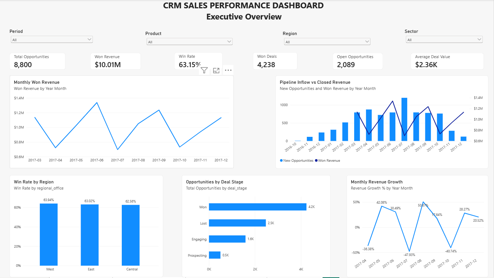
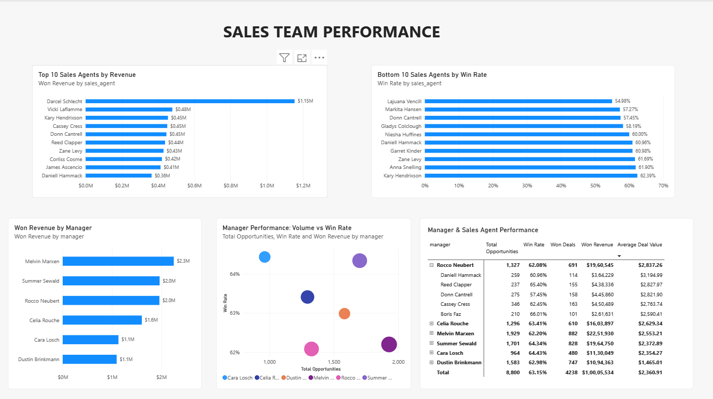
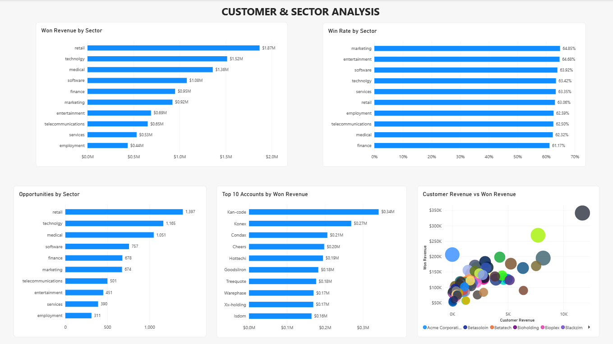
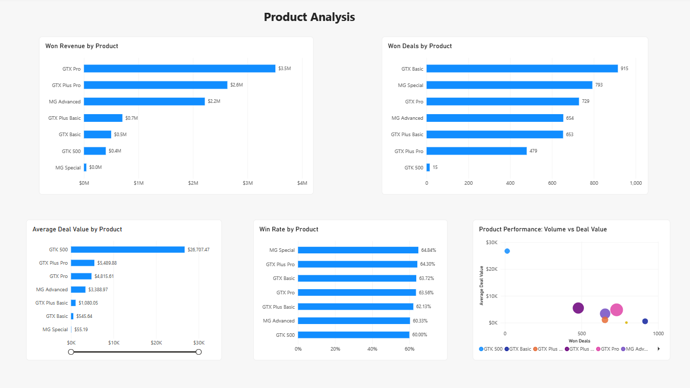
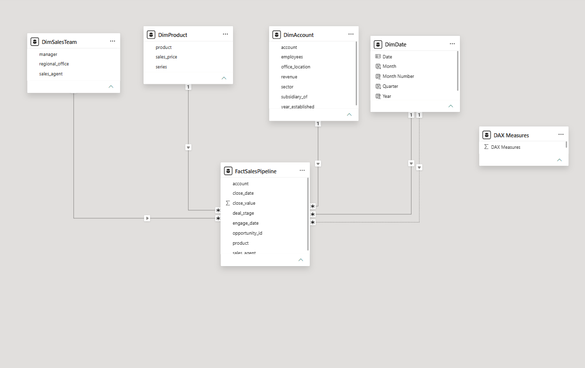

# CRM Sales Performance Dashboard

A complete **Power BI CRM Sales Analytics project** designed to transform raw sales opportunity data into an interactive business intelligence dashboard.

The project analyzes the complete sales pipeline across **revenue, opportunities, sales teams, customers, sectors, products, and time**, using Power Query, dimensional modeling, DAX, and interactive Power BI visualizations.

---

## 📊 Dashboard Overview

The final report contains four analytical pages:

1. **Executive Overview**
2. **Sales Team Performance**
3. **Customer & Sector Analysis**
4. **Product Analysis**

---

## 🎯 Project Objective

The objective of this project was to build an end-to-end Power BI solution that answers important CRM and sales-performance questions such as:

- How many sales opportunities are in the CRM pipeline?
- How much revenue has been generated from won deals?
- What percentage of closed deals are successfully converted?
- How does revenue change over time?
- How does new pipeline creation compare with closed revenue?
- Which sales agents and managers perform best?
- Which products generate the highest revenue?
- Which customer sectors contribute the most business?
- Which customer accounts generate the most revenue?
- How do deal volume, deal value, and revenue interact?

---

# 📌 Key KPIs

| KPI | Result |
|---|---:|
| Total Opportunities | 8,800 |
| Won Deals | 4,238 |
| Won Revenue | $10.01M |
| Win Rate | 63.15% |
| Open Opportunities | 2,089 |
| Average Deal Value | $2.36K |

---

# 🖥️ Dashboard Pages

## 1. Executive Overview

The Executive Overview provides a high-level picture of overall CRM sales performance.



### Key components

- Total Opportunities
- Won Revenue
- Win Rate
- Won Deals
- Open Opportunities
- Average Deal Value
- Monthly Won Revenue
- Pipeline Inflow vs Closed Revenue
- Win Rate by Region
- Opportunities by Deal Stage
- Monthly Revenue Growth

### Interactive filters

Users can dynamically filter the dashboard by:

- Period
- Product
- Region
- Sector

This page is designed to help decision-makers quickly understand the current state of the sales pipeline and overall commercial performance.

---

## 2. Sales Team Performance

This page analyzes performance across individual sales agents and managers.



### Key components

- Top 10 Sales Agents by Revenue
- Bottom 10 Sales Agents by Win Rate
- Won Revenue by Manager
- Manager Performance: Volume vs Win Rate
- Manager & Sales Agent Performance Matrix

The matrix supports hierarchical analysis from:

**Manager → Sales Agent**

and includes:

- Total Opportunities
- Won Deals
- Win Rate
- Won Revenue
- Average Deal Value

This makes it possible to compare both sales volume and conversion effectiveness across the sales organization.

---

## 3. Customer & Sector Analysis

This page focuses on customer accounts and industry-sector performance.



### Key components

- Won Revenue by Sector
- Win Rate by Sector
- Opportunities by Sector
- Top 10 Accounts by Won Revenue
- Customer Revenue vs Won Revenue

The customer scatter analysis helps investigate whether larger customer organizations also generate more won revenue.

Bubble size represents the number of won deals.

---

## 4. Product Analysis

This page evaluates product-level commercial performance.



### Key components

- Won Revenue by Product
- Won Deals by Product
- Average Deal Value by Product
- Win Rate by Product
- Product Performance: Volume vs Deal Value

The product performance scatter plot combines three business metrics:

- **X-axis:** Won Deals
- **Y-axis:** Average Deal Value
- **Bubble Size:** Won Revenue

This allows products to be compared simultaneously across sales volume, deal value, and total revenue contribution.

---

# 🗂️ Data Model

The project uses a **star-schema data model** with `FactSalesPipeline` as the central fact table.



## Fact Table

### `FactSalesPipeline`

Contains individual CRM sales opportunities.

Key fields include:

- `opportunity_id`
- `sales_agent`
- `product`
- `account`
- `deal_stage`
- `engage_date`
- `close_date`
- `close_value`

---

## Dimension Tables

### `DimAccount`

Contains customer information including:

- Account
- Sector
- Employees
- Revenue
- Office Location
- Year Established
- Subsidiary Information

### `DimProduct`

Contains product information including:

- Product
- Product Series
- Sales Price

### `DimSalesTeam`

Contains organizational sales information including:

- Sales Agent
- Manager
- Regional Office

### `DimDate`

Dedicated Date dimension created for time-intelligence analysis.

Includes:

- Date
- Month
- Month Number
- Quarter
- Year
- Year Month

---

# 🔗 Relationships

The model follows a standard one-to-many dimensional structure:

```text
DimSalesTeam ───────┐
                    │
DimProduct ─────────┤
                    │
DimAccount ─────────┼──► FactSalesPipeline
                    │
DimDate ────────────┘
```

Dimension tables filter the central fact table using **single-direction relationships**.

The primary date relationship is:

```text
DimDate[Date]
        │
        ▼
FactSalesPipeline[close_date]
```

This relationship is active and is used for closed-deal and revenue analysis.

A second relationship exists between:

```text
DimDate[Date]
        │
        ▼
FactSalesPipeline[engage_date]
```

This relationship is inactive and is activated when required using the DAX function:

`USERELATIONSHIP()`

This allows a single Date dimension to support multiple business-date contexts.

---

# 🧹 Data Preparation with Power Query

Power Query was used to clean, validate, and prepare the raw CRM datasets before loading them into the data model.

Key preparation steps included:

- Promoting the first row to column headers
- Assigning appropriate data types
- Standardizing inconsistent product names
- Checking null and empty values
- Validating unique business keys
- Reviewing column quality
- Reviewing column distributions
- Checking distinct and unique values
- Preparing fact and dimension tables
- Verifying date fields
- Validating revenue and opportunity fields

Data profiling was performed across the **entire dataset** rather than only the default preview sample.

---

# 🧮 DAX Measures

A dedicated **DAX Measures** table is used to keep calculations separate from raw fact-table columns.

The project includes the following measures:

- Total Opportunities
- Won Deals
- Lost Deals
- Closed Deals
- Open Opportunities
- Win Rate
- Loss Rate
- Won Revenue
- Average Deal Value
- New Opportunities
- Opportunity Growth %
- Revenue Growth %

Full measure documentation is available here:

[View DAX Measures](docs/dax-measures.md)

---

## Total Opportunities

```DAX
Total Opportunities =
DISTINCTCOUNT(
    FactSalesPipeline[opportunity_id]
)
```

Counts unique CRM opportunities using the opportunity business key.

---

## Won Deals

```DAX
Won Deals =
CALCULATE(
    [Total Opportunities],
    FactSalesPipeline[deal_stage] = "Won"
)
```

Counts opportunities whose deal stage is `Won`.

---

## Lost Deals

```DAX
Lost Deals =
CALCULATE(
    [Total Opportunities],
    FactSalesPipeline[deal_stage] = "Lost"
)
```

Counts opportunities whose deal stage is `Lost`.

---

## Closed Deals

```DAX
Closed Deals =
[Won Deals] + [Lost Deals]
```

Represents all completed opportunities.

---

## Open Opportunities

```DAX
Open Opportunities =
CALCULATE(
    [Total Opportunities],
    FactSalesPipeline[deal_stage] IN {
        "Prospecting",
        "Engaging"
    }
)
```

Counts opportunities that are still active within the sales pipeline.

---

## Win Rate

```DAX
Win Rate =
DIVIDE(
    [Won Deals],
    [Closed Deals],
    0
)
```

Measures the percentage of closed deals that were successfully won.

---

## Loss Rate

```DAX
Loss Rate =
DIVIDE(
    [Lost Deals],
    [Closed Deals],
    0
)
```

Measures the percentage of closed deals that were lost.

---

## Won Revenue

```DAX
Won Revenue =
CALCULATE(
    SUM(FactSalesPipeline[close_value]),
    FactSalesPipeline[deal_stage] = "Won"
)
```

Calculates revenue generated only from successfully won opportunities.

---

## Average Deal Value

```DAX
Average Deal Value =
DIVIDE(
    [Won Revenue],
    [Won Deals],
    0
)
```

Calculates the average revenue generated per won deal.

---

## New Opportunities

```DAX
New Opportunities =
CALCULATE(
    [Total Opportunities],
    USERELATIONSHIP(
        DimDate[Date],
        FactSalesPipeline[engage_date]
    )
)
```

Uses the inactive engagement-date relationship to calculate when new opportunities entered the sales pipeline.

---

## Opportunity Growth %

```DAX
Opportunity Growth % =
VAR PrevMonthOpps =
    CALCULATE(
        [New Opportunities],
        DATEADD(
            DimDate[Date],
            -1,
            MONTH
        )
    )
RETURN
    IF(
        ISBLANK(PrevMonthOpps) || PrevMonthOpps = 0,
        BLANK(),
        DIVIDE(
            [New Opportunities] - PrevMonthOpps,
            PrevMonthOpps
        )
    )
```

Calculates month-over-month growth in newly created sales opportunities.

---

## Revenue Growth %

```DAX
Revenue Growth % =
VAR PrevMonthRevenue =
    CALCULATE(
        [Won Revenue],
        DATEADD(
            DimDate[Date],
            -1,
            MONTH
        )
    )
RETURN
    IF(
        ISBLANK(PrevMonthRevenue) || PrevMonthRevenue = 0,
        BLANK(),
        DIVIDE(
            [Won Revenue] - PrevMonthRevenue,
            PrevMonthRevenue
        )
    )
```

Calculates month-over-month growth in won revenue.

---

# 💡 Key Business Insights

Several useful observations emerged from the analysis.

### Sales Pipeline

The CRM dataset contains **8,800 sales opportunities**, providing a substantial pipeline for performance analysis.

### Conversion Performance

The overall win rate is approximately **63.15%**, meaning nearly two-thirds of completed opportunities resulted in successful deals.

### Revenue

Won opportunities generated approximately **$10.01 million in revenue**.

### Product Performance

Product performance varies significantly.

Some products generate high revenue primarily through greater sales volume, while others generate value through larger individual deal sizes.

The product-performance scatter plot makes these differences easier to identify.

### Regional Performance

Win rates across the major sales regions are relatively close, suggesting that regional location alone does not strongly explain overall conversion differences.

### Sales Team Performance

Individual sales agents show noticeable variation in both:

- Revenue contribution
- Conversion effectiveness

The manager-level analysis also demonstrates differences in opportunity volume and win-rate performance.

### Sector Performance

Retail and technology represent major contributors to total sales activity and won revenue.

However, high opportunity volume does not automatically imply the highest conversion rate.

### Customer Analysis

A number of customer accounts contribute disproportionately to total won revenue.

The customer scatter analysis indicates a relationship between customer size and won revenue, although company size alone does not completely explain sales performance.

### Time Trends

Monthly won revenue shows meaningful volatility.

Analyzing revenue alongside new opportunity creation provides a more complete picture because opportunities may require time to progress through the sales pipeline before closing.

---

# 🛠️ Tools & Skills Demonstrated

## Power BI

- Dashboard development
- KPI design
- Interactive reports
- Cross-filtering
- Slicers
- Drill-down analysis
- Matrix visualizations
- Scatter plots
- Combination charts
- Time-series analysis
- Business storytelling

## Power Query

- Data cleaning
- Data transformation
- Data profiling
- Type management
- Missing-value analysis
- Data-quality validation
- Column distribution analysis

## DAX

- `CALCULATE`
- `DIVIDE`
- `DISTINCTCOUNT`
- `VAR`
- `IF`
- `ISBLANK`
- `DATEADD`
- `USERELATIONSHIP`
- `REMOVEFILTERS`
- Filter context
- Time intelligence

## Data Modeling

- Star schema
- Fact tables
- Dimension tables
- One-to-many relationships
- Single-direction filtering
- Active relationships
- Inactive relationships
- Dedicated Date table
- Multiple date contexts
- Measure organization

---

# 📁 Repository Structure

```text
CRM-Sales-Performance-Dashboard/
│
├── README.md
│
├── dashboard/
│   └── CRM-Sales-Performance-Dashboard.pbix
│
├── screenshots/
│   ├── 01-executive-overview.png
│   ├── 02-sales-team-performance.png
│   ├── 03-customer-sector-analysis.png
│   └── 04-product-analysis.png
│
├── docs/
│   ├── data-model.png
│   └── dax-measures.md
│
└── data/
    └── dataset-source.md
```

---

# 📂 Dataset

The project uses the **CRM Sales Opportunities** dataset from Maven Analytics.

The dataset represents the sales pipeline of a fictitious B2B computer hardware company and contains information about:

- Sales opportunities
- Customer accounts
- Products
- Sales teams
- Deal stages
- Engagement dates
- Closing dates
- Deal values

Additional dataset information and attribution are available in:

[Dataset Documentation](data/dataset-source.md)

---

# 🚀 How to Use the Project

1. Download or clone this repository.
2. Open:

```text
dashboard/CRM-Sales-Performance-Dashboard.pbix
```

3. Open the file using **Microsoft Power BI Desktop**.
4. Navigate through the four dashboard pages.
5. Use the available filters and interactive visualizations to explore the sales data.

---

# 📈 Project Workflow

The project follows an end-to-end analytics workflow:

```text
Raw CRM Data
      ↓
Power Query
      ↓
Data Cleaning & Validation
      ↓
Star Schema Modeling
      ↓
DAX Measure Development
      ↓
Interactive Visualizations
      ↓
Business Analysis
      ↓
CRM Sales Performance Dashboard
```

---

# 🔮 Potential Future Improvements

Possible extensions to the project could include:

- Sales forecasting
- Pipeline aging analysis
- Average sales-cycle duration
- Revenue forecasting by product
- Conversion analysis by pipeline stage
- Deal probability modeling
- Sales-agent target tracking
- Year-over-year comparisons with additional historical data
- Power BI Service deployment
- Automated data refresh
- Row-level security
- Integration with SQL-based data pipelines

These were intentionally left outside the current project scope to keep the dashboard focused on descriptive and diagnostic sales analytics.

---

# ✅ Project Status

**Completed — Version 1.0**

The final solution includes:

- Data cleaning
- Data profiling
- Dimensional modeling
- DAX calculations
- Time intelligence
- Interactive filtering
- Four analytical dashboard pages
- Business insights
- Technical documentation

---

# 👤 Author

**Sandeep Devasani**

Master's student focused on **Data Analytics, Data Science, Analytics Engineering, and AI**, with an interest in transforming business data into actionable insights using:

- Power BI
- SQL
- Python
- Data Modeling
- Business Intelligence

---

## ⭐ About This Project

This project was developed as a portfolio project to demonstrate practical end-to-end **Business Intelligence and Data Analytics** skills.

The dataset represents a fictitious organization and is not associated with any real employer or company.

If you found the project useful, feel free to explore the report, review the DAX documentation, or use the repository as inspiration for your own analytics projects.